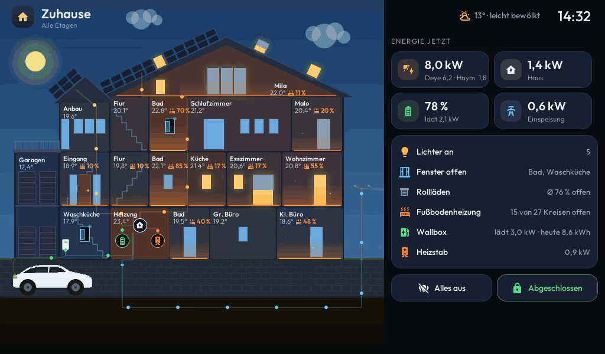
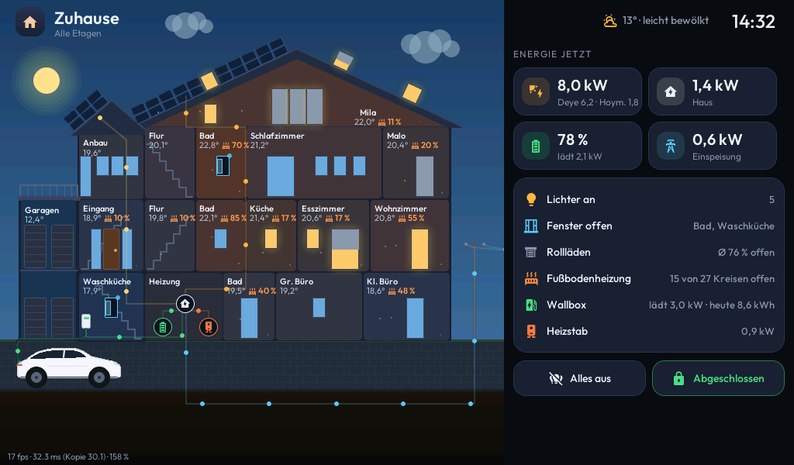
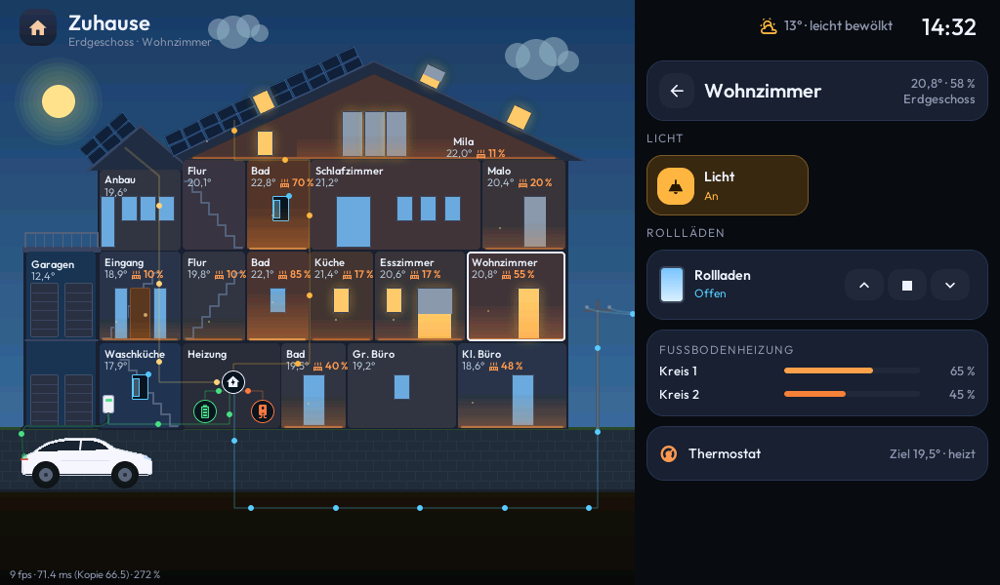

<div align="center">

# 🏡 ESPHome House Panel

### A living cross-section of your home for Home Assistant, on a 7″ ESP32-P4 display

**Every room, window, shutter, light and heating circuit of the house in one animated picture, with the energy flowing through it.**
Built with ESPHome and LVGL for the Guition JC1060P470C (1024 × 600).

[](https://esphome.io/)
[](https://lvgl.io/)
[-1d4ed8)](https://devices.esphome.io/)
[](https://www.home-assistant.io/)
[](LICENSE)
<br>
[](https://github.com/firsttris/esphome-house-panel/actions/workflows/build.yml)
[](https://github.com/firsttris/esphome-house-panel/actions/workflows/screenshots.yml)

[Features](#-features) •
[Hardware](#-hardware) •
[Getting started](#-getting-started) •
[Your own house](#-your-own-house) •
[Preview on your PC](#%EF%B8%8F-preview-on-your-pc) •
[Troubleshooting](#-troubleshooting) •
[Related projects](#-related-projects)



<sub>Recorded from the real firmware, built for the desktop with SDL. The user interface is in German; all labels are plain text in the configuration.</sub>

</div>

---

## 📸 Screenshots

All screenshots are rendered from the firmware in CI on every change, with sample values.

 

## ✨ Features

**The house (left)**
- **Rooms coloured by temperature**, from cool blue to warm, with name, temperature and heating valve opening
- **Windows that live:** they glow warm when the light is on, the roller shutter sits at its real position, and an open window swings its sash inwards with a pulsing dot. All three at the same time.
- **Floor heating:** thin heat waves rising from the floor, like the heating icon; faster and more of them the wider the valves are open
- **Energy flow:** glowing comets with a short tail run from the solar modules to the inverter, battery, heating rod, the car at the wallbox and, via the pole and the overhead line, to or from the grid. Lines with current light up; faster with more power, pink when buying, blue when selling.
- **Day and night** from the sun's position: sun or moon and stars, dark windows at night
- **Smoke alarm:** the room pulses red and a warning appears
- Tap a room to open it on the right

**The side panel (right)**
- **Overview:** solar (Deye + Hoymiles), house, battery and grid; lights on, open windows, shutters, heating circuits, wallbox, heating rod; "all off" and the front door lock
- **Room:** light tiles (ceiling lamps swing when switched), shutters with ▲ ■ ▼, window contacts, one bar per heating circuit, thermostat target and state

Also: clock and weather in the header, dimming after 1 min, a sleep screen with a large clock after 3 min, a loading screen until Home Assistant is connected.

## 🛒 Hardware

| | |
|---|---|
| **Display** | Guition **JC1060P470C**, module JC-ESP32P4-M3: ESP32-P4 + ESP32-C6 (Wi-Fi 6), 16 MB flash, 7″ IPS 1024 × 600, capacitive touch (GT911), 100 Mbit Ethernet |
| **Panel revision** | Boards with **"V2"** on the label on the back use `base/hardware-v2.yml` (see below) |
| **Network** | Wi-Fi via the ESP32-C6 by default; Ethernet is prepared in `base/hardware.yml` |

## 🚀 Getting started

| Requirement | |
|---|---|
| **ESPHome** | 2026.7 or newer, locally or as a container (see [`docker-compose.yml`](docker-compose.yml)) |
| **Home Assistant** | ESPHome integration; tick **"Allow the device to perform Home Assistant actions"** for the panel |

```bash
git clone https://github.com/firsttris/esphome-house-panel.git
cd esphome-house-panel
cp secrets.example.yaml secrets.yaml   # Wi-Fi, API key, fallback hotspot password
docker compose up -d                   # ESPHome dashboard on http://localhost:6052
```

1. **Panel revision:** if the label on the back says **V2**, open [`base/device.yml`](base/device.yml) and replace `hardware.yml` with `hardware-v2.yml`. The wrong file gives a white screen with a vertical noise band.
2. Connect the display via USB. In the dashboard choose `house.yml` → **Install** → **Plug into this computer**.
3. Home Assistant finds the new device. Add it with the API key from `secrets.yaml`.
4. In the device options tick **"Allow the device to perform Home Assistant actions"**, otherwise the panel shows states but cannot switch anything.
5. From now on, updates go over Wi-Fi: **Install** → **Wirelessly**.

> 💡 Use a separate API key per device: `openssl rand -base64 32`

## 🧩 Your own house

**Entities** live in [`house.yml`](house.yml): energy sensors at the top, then one line per device, grouped by room:

```yaml
substitutions:
  pv_power: sensor.inverter_pv_power
  battery_power: sensor.battery_power      # + discharging / - charging
  grid_power: sensor.grid_power            # + buying / - selling
  ...

packages:
  wohnen_climate: !include { file: bindings/room.yml, vars: { room: wohnen, entity_id: climate.living_room } }
  wohnen_light_0: !include { file: bindings/light.yml, vars: { room: wohnen, idx: 0, entity_id: switch.living_room, text: Licht } }
  wohnen_cover_0: !include { file: bindings/cover.yml, vars: { room: wohnen, idx: 0, entity_id: cover.living_room, text: Rollladen } }
```

| Building block | What it shows | vars |
|---|---|---|
| [`bindings/room.yml`](bindings/room.yml) | room colour, temperature, humidity, thermostat target and state | `room`, `entity_id` (climate) |
| [`bindings/light.yml`](bindings/light.yml) | windows glow, light tile | `room`, `idx`, `entity_id`, `text`, optional `swing: false` |
| [`bindings/cover.yml`](bindings/cover.yml) | shutter of the window with the same index | `room`, `idx`, `entity_id`, `text` |
| [`bindings/contact.yml`](bindings/contact.yml) | open window | `room`, `idx`, `entity_id`, `text` |
| [`bindings/circuit.yml`](bindings/circuit.yml) | floor heating valve (0–1 or 0–100 %) | `room`, `idx`, `entity_id`, `text` |
| [`bindings/smoke.yml`](bindings/smoke.yml) | smoke alarm | `room`, `entity_id` |

**The floor plan** (rooms, positions, windows and which shutter or contact belongs to which window) is the table at the top of [`core/house.h`](core/house.h), in the coordinates of the mockup (692 × 640). Window types: normal window, balcony door, sliding door, side light, triple window, roof windows. The static picture (roofs, walls, solar modules, garages, yard, car, pole) is drawn in `render_canvas()` in the same file.

## 🖼️ Preview on your PC

The interface also builds as an SDL window, with sample values from [`preview/demo.yml`](preview/demo.yml). [`preview/render.sh`](preview/render.sh) builds the preview, opens a room and saves screenshots to `preview/shots/house/`; with `GIF=1` it also records the demo GIF. It needs ESPHome plus `libsdl2-dev`, `xvfb`, `imagemagick`, `xdotool` and `ffmpeg`:

```bash
sh preview/render.sh house.yml
GIF=1 sh preview/render.sh house.yml
```

The [Screenshots workflow](.github/workflows/screenshots.yml) does the same on every push and commits changed images to `docs/`.

## 🗂️ Project structure

```
house.yml           settings + one line per device
base/               hardware (P4, display, touch, Wi-Fi/Ethernet), network
core/
  house.h           floor plan, drawing, animations, energy flow, side panel (C++)
  lvgl.yml          screen layout, header, sleep and loading screen
  logic.yml         wiring, actions, clock, weather, day/night, energy sensors
  fonts.yml         Outfit + Material Design Icons
bindings/           one file per kind of device
preview/            SDL preview, sample values, screenshot, GIF and social image scripts
```

## 🔧 Troubleshooting

| Problem | Solution |
|---|---|
| White screen with a vertical noise band | Wrong panel revision: switch between `hardware.yml` and `hardware-v2.yml` in `base/device.yml` |
| Flashing over USB fails | Hold **BOOT**, press **RST** briefly, release BOOT, then flash again |
| Panel shows states but nothing switches | Tick **"Allow the device to perform Home Assistant actions"** in the ESPHome integration |
| A room stays grey or shows "--°" | The climate entity of that room is missing or wrong in `house.yml` |
| No rising heat waves | The floor heating entities report 0, or the valve level is not 0–1/0–100 |
| Wallbox stays "bereit" | Set `wallbox_power` and `wallbox_energy_today` to your wallbox entities |

## 🔗 Related projects

- [**ESPHome Room Panel**](https://github.com/firsttris/esphome-room-panel): the same style for a single room on a 4″ 480 × 480 display
- [**ESPHome Energy Dashboard**](https://github.com/firsttris/esphome-energy-dashboard): energy flow with solar, battery, grid and gas
- [**kachelwerk**](https://github.com/firsttris/kachelwerk): Home Assistant cards that feel like an app

## 🙏 Credits

The hardware configuration for the JC1060P470C (both panel revisions) is based on
[agillis/esphome-modular-lvgl-buttons](https://github.com/agillis/esphome-modular-lvgl-buttons) (MIT).

## 📄 License

[MIT](LICENSE)
